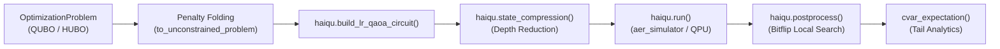

# Antigravity Haiqu Skill

[](https://docs.haiqu.ai)
[](https://github.com/haiqu-ai)
[](LICENSE)

Official Google Antigravity skill for developing, compiling, compressing, and benchmarking quantum algorithms on the **Haiqu Quantum Platform** using **Haiqu SDK (v1.6.0+)** and **Haiqu AgenticOS**.

---

## Capabilities

- ⚛️ **Modern Combinatorial Optimization:** Native support for QUBO and higher-order HUBO using `qiskit_addon_opt_mapper.problems.OptimizationProblem`.
- 🗜️ **Circuit State Compression:** Proprietary ansatz compression via `haiqu.state_compression` that slashes circuit depth before hardware submission.
- ⚡ **Linear-Ramp QAOA:** Automated LR-QAOA compilation via `haiqu.build_lr_qaoa_circuit`.
- 🔄 **Server-Side Postprocessing:** Classical bitflip local search (`haiqu.postprocess`) and Conditional Value at Risk (`cvar_expectation`) analytics.
- 🌐 **Cloud Execution:** Direct submission to `aer_simulator` and physical QPUs via `haiqu.run`.
- 🔬 **Geometric Quantum ML:** SU(2)-equivariant ansätze and variational optimization for physics simulations.

---

## Installation

### In Google Antigravity
Clone or copy this repository into your Antigravity skills directory:
```bash
git clone https://github.com/arunnadarasa/antigravity-haiqu.git ~/.gemini/config/skills/antigravity-haiqu
```

### Python Dependencies
Install the required packages in your Python environment:
```bash
pip install haiqu-sdk qiskit qiskit-addon-opt-mapper python-dotenv
```

Set your Haiqu API key in `.env`:
```env
HAIQU_API_KEY=your_haiqu_api_key_here
```

---

## Quickstart

### 1. Verify Stack Health
Run the automated diagnostic health check:
```bash
python scripts/verify_haiqu_stack.py
```

### 2. Run a Parameterized QAOA Experiment
```bash
python scripts/run_qaoa_experiment.py --vars 6 --shots 1000 --compress
```

### 3. Benchmark Circuit Compression
```bash
python scripts/compress_circuit.py --qubits 4 --depth 20
```

---

## Architecture: The Modern Modular Workflow

As of **Haiqu SDK 1.6.0**, the legacy `QUBO` class and `haiqu.solve_qubo` shortcut are deprecated. This skill enforces the modern modular standard:



### Python Workflow Example
```python
import os
from dotenv import load_dotenv
from haiqu.sdk import haiqu
from haiqu.sdk.optimization import cvar_expectation, is_constrained, to_unconstrained_problem
from qiskit_addon_opt_mapper.problems import OptimizationProblem

load_dotenv()
haiqu.login(api_access_key=os.getenv("HAIQU_API_KEY"))

# 1. Define problem
prob = OptimizationProblem("my_optimization_task")
prob.binary_var_list(4)
prob.minimize(linear=[-1.0, -2.5, -3.0, -1.8], quadratic={(0, 1): 4.0, (2, 3): 3.5})

# 2. Compile LR-QAOA circuit
circuit = haiqu.build_lr_qaoa_circuit(prob)

# 3. Compress circuit
comp_job = haiqu.state_compression(circuit)
compressed_circuit = comp_job.result()

# 4. Execute on backend
job = haiqu.run(compressed_circuit, shots=1000, device_id="aer_simulator")
raw_counts = job.result()[0]

# 5. Classical postprocessing & CVaR
costs, processed_counts = haiqu.postprocess(counts=raw_counts, problem=prob, postprocess_iterations=5)
cvar_10 = cvar_expectation(raw_counts, problem=prob, alpha=0.1)

best_bitstring = min(costs, key=costs.get)
print(f"Optimal solution: {best_bitstring} | Cost: {costs[best_bitstring]:.4f} | CVaR: {cvar_10:.4f}")
```

---

## Repository Structure

- [`SKILL.md`](SKILL.md): Comprehensive Antigravity skill specification, agent prompt instructions, and API guide.
- [`scripts/verify_haiqu_stack.py`](scripts/verify_haiqu_stack.py): Diagnostic verification script.
- [`scripts/run_qaoa_experiment.py`](scripts/run_qaoa_experiment.py): Turnkey parameterized QAOA optimization runner.
- [`scripts/compress_circuit.py`](scripts/compress_circuit.py): Standalone circuit state compression benchmarking tool.

---

## License
MIT License. See [LICENSE](LICENSE) for details.
